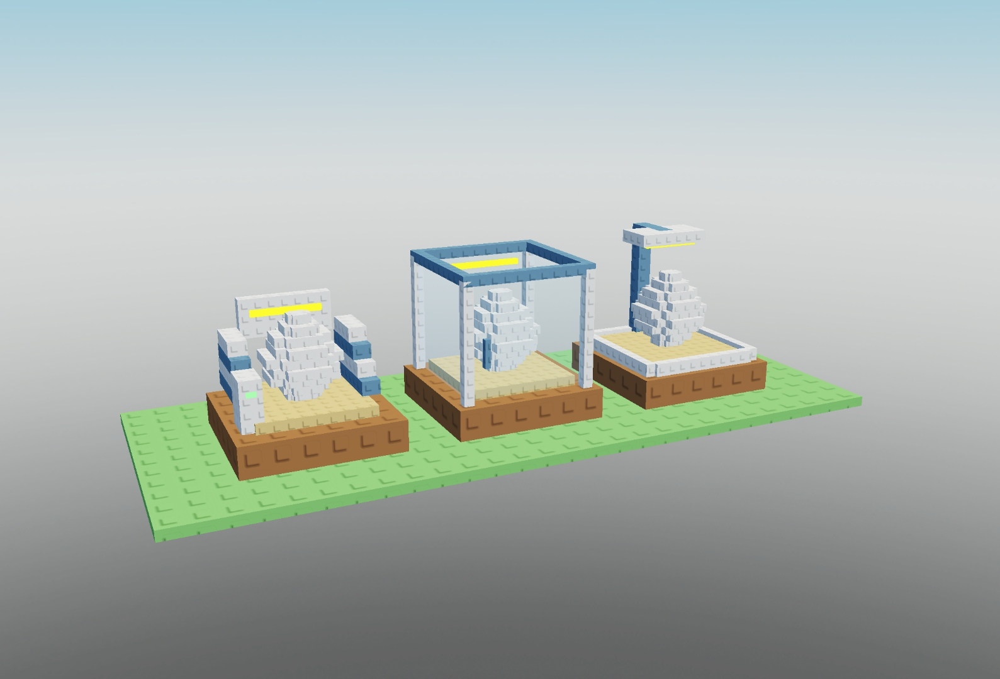

# Incubator redesign

Implemented and Studio-validated on desktop, 2026-11-16: Cross-lapped oval eggs + Tall pavilion + Quiet rows + Nearby labels. As-built behavior is in [GDD §7.6](GDD.md#76-pet-garden-minigame-p2), script APIs in [LAYOUT](LAYOUT.md). Physical phone touch and live validation remain open.

The design options and acceptance checks are archived in git: `git show d24f132:docs/INCUBATOR_REDESIGN.md`.

## Incubator body follow-up

The user requested stud-textured foundations and a future body that reads as an incubator, rather than a nest on a block.
The implemented, Studio-validated material change gives both the base and pad Plastic + the existing StudPack variants (Studs / StudsSmall), including
free and locked nests. Keep dimensions, colours, egg position and interactions.

Body concepts for review, built as client-only Studio studies with the existing egg recipe:
- **Heated cradle:** low stud rim, a rear arm and warm heater, small front thermostat. Most open and garden-like.
- **Glass-sided cabinet:** stud chassis, clear side / rear walls, front handle and heater bar. Most obviously a machine,
  with a risk of reflections and frame edges obscuring the egg.
- **Open hatch pod:** stepped side cheeks around the egg's lower half, rear heater and side control module. A compact
  machine silhouette with an open front and top; preferred starting point.

Left to right: **Open hatch pod**, **Glass-sided cabinet**, **Heated cradle**. All fit the existing 6 × 6 footprint.
Rebuild the client-only models by executing `tools/incubator_body_review.luau` through MCP's Client context in a Studio
playtest (models around 0, 1000, 0; delete Workspace.IncubatorBodyReview afterwards). The tool does not change the camera.

The studies do not change the live incubator body. Review egg visibility from the plaza and orbiting cameras, footprint
(6 × 6 studs), access, stud scale and part count before selecting a body. No new gameplay controls or timed actions.
