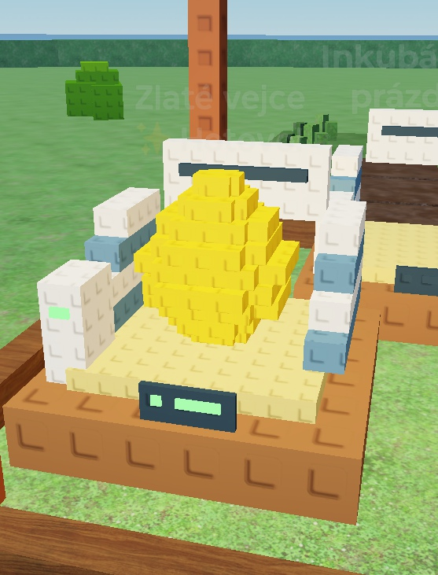

# Incubator redesign

Implemented and Studio-validated on desktop, 2026-11-16: Cross-lapped oval eggs + Tall pavilion + Quiet rows + Nearby labels + Open hatch pod bodies (selected by the user). As-built behavior is in [GDD §7.6](GDD.md#76-pet-garden-minigame-p2), script APIs in [LAYOUT](LAYOUT.md). Physical phone touch and live validation remain open.

Earlier design options / acceptance checks: `git show d24f132:docs/INCUBATOR_REDESIGN.md`. The three body concepts and their disposable Studio builder are archived at `git show 44431fe:docs/INCUBATOR_REDESIGN.md` and `git show 44431fe:tools/incubator_body_review.luau`.
