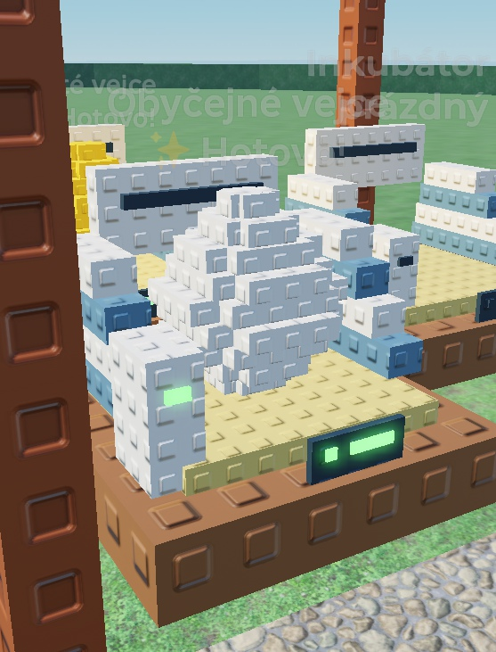

# Incubator redesign

## Number plates and foundation (2026-11-17, desktop Studio-validated)

Mount a small two-sided number plate above each pod's rear heater at full / mid detail; distant low detail stays simple.
Floating empty / locked labels retain only status. Convert the plot strip's wooden edge beams to Plastic / Inlets to match
the hatchery pavilion. Keep footprints, collision, timers and interaction unchanged.
Acceptance: numbers 1–3 readable from front / rear, including occupied / locked nests; no floating incubator numbers;
clean plate joints at three plot rotations; no Wood / WoodPlanks in the drawn strip; fresh Studio boot without errors.

Validation: full / mid / low at yaw 0 / 90 / 180 use 28 / 8 / 3 body Parts; two-sided numbers match and the static coplanar
audit is clean. Front / rear views checked with occupied, empty and locked pods; number text fits both faces. Raised busy
status to clear the plate, and extended the click target to 7 × 6.5 × 7. Fresh boot confirms final offsets; clicking the upper
plate opens the hatchery, and Close works. All six strip edges are Plastic / Inlets, with no wooden parts in the strip or
pavilion. Both boots have no client / server errors or warnings. Visual fixtures changed only the client's public plot,
without profile writes; removed all temporary review models and stopped playtests. Localization build / check / lint pass.
Changed Czech: `🔒 Zamčeno`, `Prázdný` (floating statuses; number is now on the model).

2026-11-17 surface fix: control housing width 0.68 leaves its inner face 0.06 studs clear of the lower cheek; simplified side
bottoms embed in the base instead of sharing the nest's bottom plane. Coplanar audit clean for full / mid / low at 0° / 90° / 180°;
Studio boot checked. The visible top edges, footprint and part counts are unchanged.

2026-11-17 phases: 30 s cyan scanning sweep + travelling edge light / fading trail + Scanning… (inside the existing hatch timer), then a soft pulsing amber nest glow
and countdown; ready stays green with warming off. Stored anchors survive rejoin; instant-ready eggs skip the scan.
Desktop Studio-validated. Phase scope, visual review and validation: `git show f636dd0:docs/INCUBATOR_REDESIGN.md`.
Travelling-light C scope and validation: `git show 0a76951:docs/INCUBATOR_REDESIGN.md`.

2026-11-17 access: Hatchery HUD beside Barn (ready-egg badge) near the own plot, or click/tap any own incubator from either side.
Whole-pod hover; no hatchery E prompt. Barn keeps its existing availability; visible farm buttons center together.
Desktop Studio-validated; physical touch and live checks remain open. Access scope and validation: `git show 285eb18:docs/INCUBATOR_REDESIGN.md`.

2026-11-17: egg kind is fixed at purchase / free placement and hidden server-side until Hatch. New eggs use shared tiers:
Common / Uncommon 5 m, Rare 1 h, Epic / Legendary 4 h. Nest rows show only the egg and countdown. A small square trash button uses ConfirmTap:
orange OK? on first tap, discard on the second tap within 3 s; discarding gives no refund. Odds are separate rarity / percentage
rows, with only offline hatching and no-refund text in the tip. Existing deadlines and instant first pet are preserved.
Implemented and desktop Studio-validated; physical touch and live validation remain open. As built: [GDD §7.2](GDD.md#72-eggs).
Compact-action / odds scope and Studio validation: `git show b2748e8:docs/INCUBATOR_REDESIGN.md`.
Earlier hidden-pet / shared-timer validation and snapshot details: `git show e7aff11:docs/INCUBATOR_REDESIGN.md`.
Initial egg-timing validation: `git show 79e61e3:docs/INCUBATOR_REDESIGN.md`.

2026-11-17: pods and eggs now face the central path towards the barn (90° turn, plot-local −X), Studio-validated in three
plot orientations and at all detail levels. Centres, footprints and label anchors are preserved.

Implemented and Studio-validated on desktop, 2026-11-16: Cross-lapped oval eggs + Tall pavilion + Quiet rows + Nearby labels + Open hatch pod bodies (selected by the user). As-built behavior is in [GDD §7.6](GDD.md#76-pet-garden-minigame-p2), script APIs in [LAYOUT](LAYOUT.md). Physical phone touch and live validation remain open.

Earlier design options / acceptance checks: `git show d24f132:docs/INCUBATOR_REDESIGN.md`. The three body concepts and their disposable Studio builder are archived at `git show 44431fe:docs/INCUBATOR_REDESIGN.md` and `git show 44431fe:tools/incubator_body_review.luau`.
