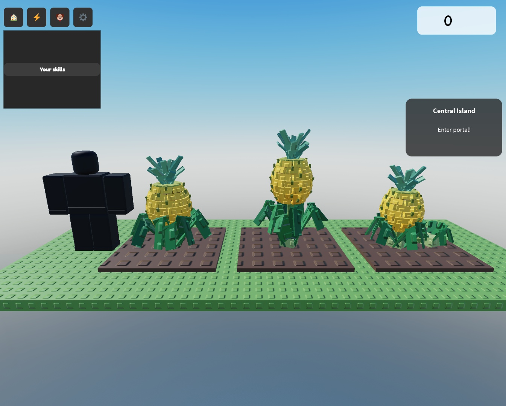

# Pineapple growth art

[Shared authoring and Studio player](../PLANT_GROWTH.md) · [Status](../ROADMAP.md)

## Selected design (CG21a, 2026-11-12)

Ales chose **B, the tall stalk**: the fruit stands on a thick stalk well above an upright leaf fountain, as in the cultivation
infographic. Growth art approved by Ales 2026-11-12 (CG21c); the recipe is registered in the field. The A and C studies stay as
the decision record.

## Mature studies (CG21a, 2026-11-12)

Crop facts: Pineapple is the 15th ladder crop (24 h, `CropConfig` id `Pineapple`, letter `s`, sale 1 200 000; annual in the game:
harvest clears the whole square, although the real plant is a perennial bromeliad that ratoons from suckers). The references are
Ales's photo of a green fruit in a rosette of long glossy strap leaves with a blue-green crown, and the
"duration of pineapple cultivation" infographic (planting, seedling, ratoon, fruit development, 0 to 520 days).

Shared rules for all three: free-standing, fixed orientation is open (the fruit is radially symmetric; a rosette can rotate by seed),
one fruit slot (`PlantRole` `Fruit`), 8 columns × 7 tiers of tilted diamond "eye" blocks (orange-gold at the base, yellow at the
top: ripe from the bottom up, like the real fruit) over two cylinder cores and a green-gold cap, small green-brown bracts on a
checker, a blue-green crown of 14 blades in three rings (outer, middle, central) with bent tips, and a rosette of long strap
leaves in the glossy dark green of the photo, each three segments rolled alternately so the blades show their faces.

 (standard mass; the reference R15 avatar is 5.18 studs;
`tools/pineapple_ripe_studies.luau`)

| | Silhouette | Reads as | Height | Parts | Ground radius |
|---|---|---|---|---|---|
| **A, classic rosette** | 2.3-stud fruit set in the heart of a 13-leaf arching rosette, crown on top | the photo: a fruit nested in sword leaves | 4.96 | 156 | 2.34 |
| **B, tall stalk** | 2.15-stud fruit lifted on a thick stalk above an upright 12-leaf fountain | the infographic's fruit towering over its foliage | 6.26 | 154 | 2.07 |
| **C, mother and sucker** | 2.0-stud fruit on a smaller rosette, with a side sucker rosette and a small slip under the fruit | the ratoon cycle: next crop already growing | 4.48 | 175 | 2.32 |

**Recommendation: A.** It matches the photo, keeps the fruit and the rosette both readable, and its low profile keeps the whole
field consistent; B is the fallback if the fruit must be visible at phone distance (it is the only one clearly taller than the
avatar), C costs the most Parts (175 of the 180 study budget) and its extra rosettes crowd the fruit at phone size.

## Proposed growth (applies to A / B / C)

| Growth | Pose |
|---|---|
| 0% | Planting: a leafy crown top (slip) pressed into the soil, three short upright blades. |
| 20% | Young rosette: eight narrow strap leaves fanning out, still upright. |
| 50% | Full rosette; leaves long and arching; the central heart rises. |
| 75% | A short stalk lifts a small green fruit with a tiny crown; pale eye pattern. |
| 100% | Fruit swells to full size, the eyes turn orange-gold from the base up, crown fully fanned. |

Production duration stays **24 hours**.

Timing (CG21b): leaves 1-4 exist from 0% as a small upright slip, the other eight sprout every 3% and each opens from a bud into its
arch over 32% (all open by 65%); the stalk rises 45-72%; the fruit appears at 56-62%, swells to 98% and rides up with the stalk; the
eight columns ripen tier by tier from the base (tier 1 at 74-86%, tier 7 at 88-100%, green to orange-gold / yellow); the crown
unfolds from an upright tuft 58-98% and turns blue-green. A 43 → 44 → 43% seek restores the same pose (pure function of growth).
Seeded variation: leaf yaw / length / height / droop, stalk lean, fruit column yaw, crown yaw.

## Static study checks

`tools/pineapple_ripe_studies.luau` (Studio Edit) built the comparison; all three fit the 2.4-stud ground radius and the
180-Part study budget (table above). The display was removed after capture and the Edit camera restored.

## Recipe and status

[`PineapplePlant.luau`](../../src/ReplicatedStorage/PineapplePlant.luau), built on `PlantKit.recipe`, **registered in `PlantGrowth`** (no `Draft`): **155 Parts**
(hub 1, leaves 12 × 3, stalk 2, fruit core 2, cap 2, eyes 56, bracts 28, crown 14 blades × 2), so a 36-square field would use 5,580
plant Parts before soil, pets or UI: the heaviest crop so far (Sweet potato 169 is the next; the mid proxy is the lever). Free-standing,
rotates with the planting, **fixed ring height 7.2**, review framing 6.4. One fruit slot (`fruitSlots[1]`: core, cap, eyes, bracts,
crown). Fruit scale follows cube-root mass up to 1.2; leaf reach is clamped to 2.36. **Mid proxy** (same geometry): 8 of 12 leaves in
two segments, stalk, core, cap, eyes on tiers 2 / 4 / 6 only, the two inner crown rings as one blade each, no bracts:
**11 / 55 / 55 Parts** for young / growing / ripe. No harvest effect (`PlayHarvest` is nil).

Studio validation (2026-11-12): [`pineapple_growth_checks.luau`](../../tools/pineapple_growth_checks.luau), six seeds × three
harvested masses (0.357 / 1 / 3.03) × 101 ages: 155 Parts, maximum ground radius **2.31 studs**, top **7.00** (ring 7.2), no NaN
poses, no leaf inside the fruit from 78%, exact visible backward seeks. [Five stills](../art/pineapple/growth-review.jpg)
(0/20/50/75/100%, seed 1, standard mass, Edit-mode side by side, not the reviewer) ·
[75% and ripe detail](../art/pineapple/growth-75-100-detail.jpg), approved by Ales (2026-11-12).

Field integration (2026-11-12): [`pineapple_integration_checks.luau`](../../tools/pineapple_integration_checks.luau) passed through the
production `PlotView` with disposable public-feed fixtures and no remotes or profile writes: three recipes build 465 Parts; a
server-time correction keeps the same plant, soil and pet; the exact ripe moment is not missed and a backward correction clears the
ripe state; the soil selection ray is not blocked; full → mid (11 / 55 / 55 Parts) → low → full keeps the seed's identity; harvest
clears the square and a replant starts young; ring height is fixed at 7.2; the 24 h crop is sampled every 30 s (the cap). Playtest boot
clean (server and client). Open: performance (5,580 plant Parts per full field, the heaviest crop; the 24-plot route), real phone,
second client.
