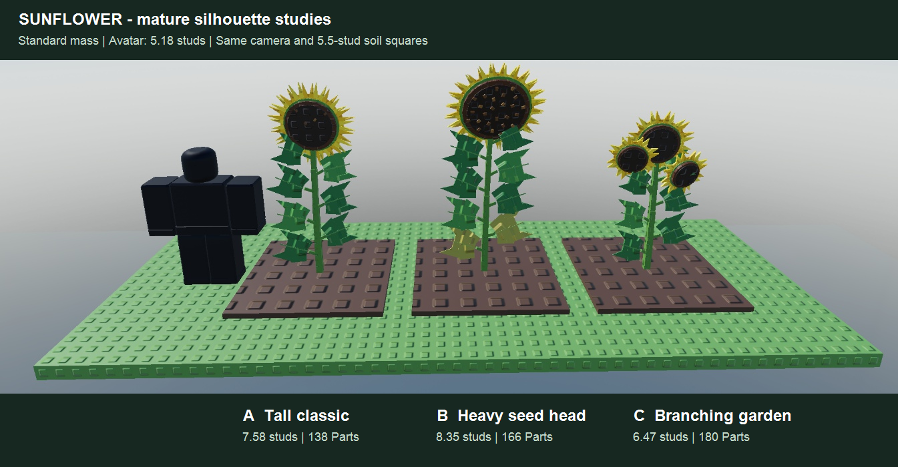

# Sunflower growth art

[Shared authoring workflow](../PLANT_GROWTH.md) · [Status](../ROADMAP.md)

## Mature studies — awaiting selection

CG20a starts with three static mature studies from Ales's [life-cycle illustration](../art/sunflower/reference-life-cycle.png)
and [flowering plant photo](../art/sunflower/reference-flowering.png) (2026-11-12). The reference captions describe the plant;
they do not change gameplay. Preserve a substantial green stem, broad pointed leaves on staggered petioles, a large dark
seed disk and a dense golden ray crown. Fine hairs and individual serrations are omitted in the stud-block style.

- **A — tall classic (recommended):** one upright, slightly leaning stem, seven broad leaves and one large open golden head.
  Closest to the flowering photo; the bloom sits clearly above the reference avatar.
- **B — heavy seed head:** a taller stalk with eight leaves, a larger dark seed disk, a gently nodding head and a few straw
  lower leaves. A stronger seed-harvest read while retaining the yellow crown.
- **C — branching garden:** a shorter forked stalk with three unequal heads and six broad leaves. An ornamental alternative
  to the single-headed reference; the central head remains tallest.

The life cycle ends with seed release and a dried plant. For the game, the proposed ripe pose retains a golden crown around
a dark textured disk, with a modest head nod and lower-leaf aging if B is selected. This combines flowering identity and
seed-readiness cues intentionally, rather than requiring the whole plant to turn brown before harvest.

## Scope and acceptance

Only mature studies are built until Ales selects a variant, per the shared review gate. Use one 5.5-stud soil square per plant,
standard mass, the same materials and camera, and a real R15 reference avatar with its feet on the same ground plane.
Every Part corner must fit a 2.4-stud ground radius; the static budget is 180 Parts per study. Show the head, foliage and
avatar scale together. The disposable study uses shared `PlantKit` part/rod helpers and must be removed after capture.

After selection, build one deterministic `PlantKit.recipe` with `Draft = true`, shared timing/seed/size helpers, attached
stem and petiole growth, hinged leaf unfolding, a green bud that opens into rays, a swelling/darkening seed disk and a late
head nod. Keep the head as one explicit visual harvest slot. Present five stills at 0/20/50/75/100% before field integration.
Head facing, seed/mass extremes, all-age bounds and detail proxies belong to the selected recipe's validation.

Stored ID `Sunflower`, existing **18-hour** duration, prices/rewards and whole-square harvest stay as built. No profile edits
or custom harvest feedback are part of this study milestone. Growth, field integration and performance remain later gates.

## Static study checks

`tools/sunflower_ripe_studies.luau` builds the comparison in Studio Edit. A / B / C measure 7.58 / 8.35 / 6.47 studs above soil,
use 138 / 166 / 180 plant Parts and have maximum Part-corner ground radii 1.76 / 2.11 / 1.93 studs. The R15 avatar is 5.18 studs tall.
The dark disk, golden rays, broad leaves, B's lower-leaf aging and all three silhouettes were checked in the rendered comparison.
The temporary display was removed after capture and the camera restored. One boot had zero server/client warnings or errors;
the playtest was stopped. Localization build/check/lint pass with no changed strings. No `SunflowerPlant` module exists yet.
