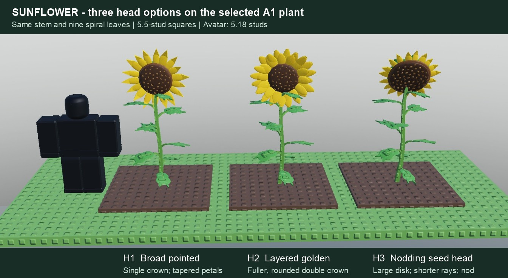
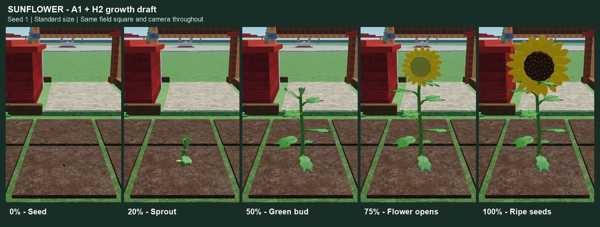

# Sunflower growth art

[Shared authoring workflow](../PLANT_GROWTH.md) · [Status](../ROADMAP.md)

## Selected: A1 stem and foliage with H2 head

Ales chose **A1's stem and foliage** on 2026-11-12 and requested other head options before growth. Keep its nine-leaf spiral,
stem path, dimensions and leaf seed fixed across the comparison. `tools/sunflower_head_studies.luau` builds these three mature
head alternatives in Studio Edit:

- **H1 — broad pointed:** one crown of wider, tapered golden petals around a textured dark disk.
- **H2 — layered golden (recommended):** two offset layers of rounded, folded petals and a slightly smaller disk for a fuller flower.
- **H3 — nodding seed head:** a larger seed disk, shorter rays and a stronger nod for a harvest-heavy silhouette.

Ales selected **H2** on 2026-11-12. The CG20b growth draft and its five stills are below; Ales approved the growth art on 2026-11-12.

The static H2 study uses 189 Parts plus 138 built-in sphere `SpecialMesh` children (327 instances excluding the Model). Its 120 head
Parts comprise 68 petal pieces (34 two-piece petals), 42 seed marks, three disk/back pieces and seven bracts; stem and foliage
use 69 Parts. A 36-square field at this study detail would contain 6,804 plant Parts plus 4,968 mesh children, before soil, pets
or UI. These static counts are geometry budgets, not measured frame time; the growth draft adds early organs and a mid proxy below.

| Head study | Height | Radius | Parts | Built-in sphere meshes |
|---|---|---|---|---|
| H1 broad pointed | 7.63 | 1.92 | 175 | 88 |
| H2 layered golden | 7.58 | 1.83 | 189 | 138 |
| H3 nodding seed head | 7.48 | 1.83 | 193 | 104 |

Standard mass, the same 5.18-stud avatar and 5.5-stud squares; all fit the 2.4-stud radius. The 69 stem/neck/leaf Parts match
between studies (138 comparisons, local pose error below 0.000001 studs). Smooth petals and raised spiral seed marks replace
the studded crown surface. The comparison faces existing daylight; place lighting was unchanged. Static costs include no
production proxy or field performance claims. The display was removed, GUI visibility and camera restored, and a playtest boot
reported zero server/client warnings or errors; it was stopped. No gameplay strings changed.

## Growth art approved — field integration pending

[`SunflowerPlant`](../../src/ReplicatedStorage/SunflowerPlant.luau) uses `PlantKit.recipe` with **`Draft = true`** (reviewer only).
The approved A1/H2 mature geometry and colours are preserved at seed 1, standard mass. Five successive stem segments carry
staggered petioles; leaf blades unfold at their attached hinges. A seed shell and two cotyledons appear early and fade away.
The green bud emerges around 43–53%, the ray layers open over 58–84%, the disk darkens over 72–98%, seeds appear over 80–99%,
and the head makes its small late nod over 84–100%. This remains a continuously posed plant with fixed topology.

Full captures: [0%](../art/sunflower/growth-000-source.jpg), [20%](../art/sunflower/growth-020-source.jpg),
[50%](../art/sunflower/growth-050-source.jpg), [75%](../art/sunflower/growth-075-source.jpg),
[100%](../art/sunflower/growth-100-source.jpg). Seed 1, standard size, the same real field square and camera throughout.

The draft reuses **192 Parts + 141 built-in sphere meshes**: the 189 mature pieces plus the seed shell and two cotyledons.
A hypothetical 36-square full-detail field is 6,912 plant Parts plus 5,076 mesh children before soil, pets and UI. The proxy
uses **12 / 45 / 45 Parts** at young / growing / ripe: fewer leaves and single-piece petals, with seed marks and veins omitted.
One explicit visual head slot contains its 120 Parts. Free orientation and seed-dependent leaf/lean/head variation retain
planting identity. Harvest mass uses cube-root head scaling capped at 1.20 for clearance, with gentler stem/leaf scaling;
the 8.9-stud ring height is fixed. No external mesh assets, new scheduler, remotes or profile changes.

Studio checks (`tools/sunflower_growth_checks.luau`) pass: six seeds × three masses × 101 ages (1,818 poses), 17,964 stem/leaf
attachment checks, 54 exact visible backward seeks, deterministic rebuilds, finite poses and fixed instance counts. Maximum
corner radius 2.275 studs; standard mature top 7.580 studs, maximum top 8.406. The mature comparison checked all 189 study Parts:
colours identical, position error below 0.001 studs. Real Play/Pause, scrubber, rings/selection with the field pet and Close were
exercised. Final server/client boot logs were clean; reviewer and playtest closed. Field registration, production PlotView
integration and full-field/24-plot/phone performance remain later gates. Ales approved these five growth poses on 2026-11-12;
the recipe stays `Draft = true` until the separate field-integration milestone.

## Earlier natural refinements of A

Ales preferred the original **A, tall classic**, but found its shape too artificial and its leaves confined to left/right rows
(2026-11-12). Keep the tall single-head direction. The revised studies give the stem a slight irregular bend, distribute unequal
leaves around all four sides, bend the petioles and blades, and replace the wheel-like crown with uneven rounded overlapping rays
and a convex dark disk. Leaf planes follow their radial growth direction, rather than all facing the viewer.

- **A1 — spiral classic (recommended):** nine unequal leaves wrap around the stalk; balanced foliage and one open golden head.
- **A2 — open field:** seven leaves, a more open silhouette, a slight sideways lean and an uneven petal crown.
- **A3 — lush crown:** ten broader leaves around the stalk, fuller foliage and a modestly nodding flower.

All are refinements of A, rather than the original B heavy seed head or C three-head branching alternatives.
[Initial silhouette comparison](../art/sunflower/ripe-studies.png) is retained as the decision record.

## References and growth direction

Ales supplied a [life-cycle illustration](../art/sunflower/reference-life-cycle.png) and
[flowering plant photo](../art/sunflower/reference-flowering.png) on 2026-11-12. Preserve a substantial green stem, broad pointed
leaves on staggered petioles, a large dark seed disk and a golden ray crown. The reference captions describe the plant;
they do not change gameplay. Fine hairs and individual serrations are omitted at gameplay scale.

The reference ends with seed release and a dried plant. The proposed game-ripe pose retains a golden crown around a dark textured
disk, with a modest head nod and limited lower-leaf aging. This intentionally combines flowering identity and seed-readiness cues.

The growth draft uses one deterministic `PlantKit.recipe` with `Draft = true`, shared timing/seed/size helpers, attached
stem and petiole growth, hinged leaf unfolding, a green bud opening into rays, a swelling/darkening disk and a late head nod.
Keep the head as one explicit visual harvest slot. Present five stills at 0/20/50/75/100% before field integration.
Head facing, seed/mass extremes, all-age bounds and detail proxies belong to the selected recipe's validation.

## Static study checks and scope

`tools/sunflower_natural_studies.luau` builds the revised comparison in Studio Edit. All three use standard mass, 5.5-stud soil
squares, the same camera and a 5.18-stud R15 avatar with its feet on the same ground plane. Part-corner radii fit the 2.4-stud
limit, with leaves checked in all four azimuth quadrants.

| Study | Leaves | Height | Radius | Parts | Built-in sphere meshes |
|---|---|---|---|---|---|
| A1 spiral classic | 9 | 7.64 | 1.83 | 146 | 95 |
| A2 open field | 7 | 7.84 | 2.14 | 124 | 83 |
| A3 lush crown | 10 | 7.58 | 2.08 | 157 | 101 |

Rounded blades, petals and disk faces use built-in `SpecialMesh` sphere ellipsoids inside the Parts; mesh instances are additional
to the Part count. These are static study costs, not production performance validation. The selected recipe should create its
bounded meshes once through framework hooks and pose the Parts through the shared Rig. No external mesh assets are needed.
The original angular studies remain reproducible with `tools/sunflower_ripe_studies.luau`.

The temporary revised display was removed after capture and the camera restored. The final boot had zero server/client warnings or
errors; the playtest was stopped. Localization build/check/lint pass with no changed strings. These checks describe the earlier static studies.

Stored ID `Sunflower`, existing **18-hour** duration, prices/rewards and whole-square harvest stay as built. No profile edits or
custom harvest feedback are part of this milestone. Growth art is approved; field integration and performance remain later gates.
