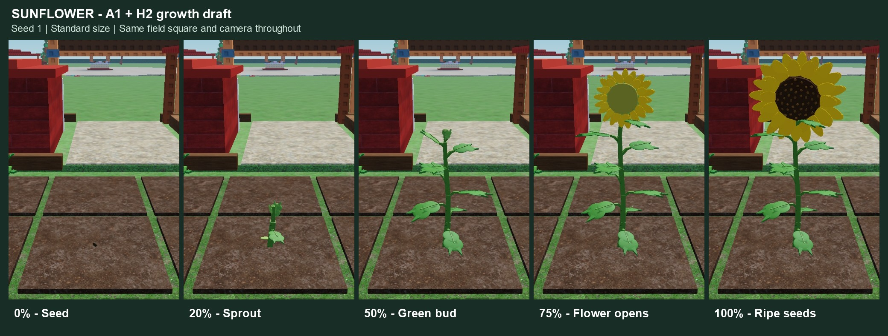

# Sunflower growth art

[Shared authoring workflow](../PLANT_GROWTH.md) · [Status](../PLANT_GROWTH.md#crops-and-status)

## Selected: A1 stem and foliage with H2 head

**A1 spiral classic stem and foliage** (nine unequal leaves wrapping the stalk, slight irregular bend, bent petioles and blades, leaf
planes following their radial direction) with the **H2 layered golden head** (two offset layers of rounded folded petals, slightly
smaller disk). Rejected: the original angular tall classic (too artificial, leaves in left/right rows), A2 open field (7 leaves, lean),
A3 lush crown (10 leaves), original B heavy seed head and C three-head branching; head H1 broad pointed and H3 nodding seed head.
[Head alternatives](../art/sunflower/head-studies.jpg) · [natural refinements](../art/sunflower/natural-studies.png) ·
[initial silhouettes](../art/sunflower/ripe-studies.png); studies: `sunflower_head_studies.luau`, `sunflower_natural_studies.luau`,
`sunflower_ripe_studies.luau`.

References: [life-cycle illustration](../art/sunflower/reference-life-cycle.png), [flowering plant photo](../art/sunflower/reference-flowering.png).
Keep a substantial green stem, broad pointed leaves on staggered petioles, a large dark seed disk and a golden ray crown; fine hairs and
serrations are omitted. The reference ends in seed release and a dried plant; the game-ripe pose keeps the golden crown around a dark
textured disk with a modest head nod and limited lower-leaf aging (flowering identity plus seed readiness).

Stored id `Sunflower`, whole-square harvest, no custom harvest effect.

## Growth

Full captures: [0%](../art/sunflower/growth-000-source.jpg), [20%](../art/sunflower/growth-020-source.jpg),
[50%](../art/sunflower/growth-050-source.jpg), [75%](../art/sunflower/growth-075-source.jpg), [100%](../art/sunflower/growth-100-source.jpg).

Five successive stem segments carry staggered petioles; leaf blades unfold at attached hinges. A seed shell and two cotyledons appear
early and fade. The green bud emerges around 43–53%, the ray layers open 58–84%, the disk darkens 72–98%, seeds appear 80–99%, and the
head makes its small late nod 84–100%. Fixed topology, continuous posing. Free orientation; seeds vary leaf, lean and head.

## Recipe

[`SunflowerPlant`](../../src/ReplicatedStorage/SunflowerPlant.luau), `PlantKit.recipe`, registered in `PlantGrowth`: **192 Parts + 141
built-in sphere `SpecialMesh` children** (189 mature pieces + seed shell + two cotyledons; mesh instances are additional to the Part
count; no external mesh assets). 36-square field 6 912 Parts + 5 076 meshes. Head = 120 Parts (68 petal pieces, 42 seed marks, three
disk/back pieces, seven bracts) as one explicit visual head slot; stem and foliage 69. Mid proxy **12 / 45 / 45 Parts**
(young / growing / ripe): fewer leaves, single-piece petals, no seed marks or veins. Harvested mass: cube-root head scaling capped at
1.20 for clearance, gentler stem / leaf scaling; ring fixed **8.9 studs**. Standard mature top 7.58 studs (max 8.44), max corner radius
2.275. Checks: `sunflower_growth_checks.luau`, `sunflower_integration_checks.luau`; the long crop is sampled at the 30 s cap.

## Performance

Desktop: one plot 13 081 objects, frame p95 18.1 ms, build work max 6.3 ms (the 6 ms budget); 24 plots (3 full / 4 mid / 17 low) 43 644
objects, same frame p95, work p95 0.54 ms. Real phone (published build, [field test](../PLANT_GROWTH.md#phone-and-performance-test))
passed: all 12 ring-1 plots in Sunflower stutter once when switched on, then 60 FPS standing; running round the ring 35–40 FPS (Garlic
above 50). The drop is full-detail build / teardown as plots cross the 60-stud line (one plant ≈ 330 instances against Garlic's ~100),
not steady drawing. Accepted (12 full Sunflower fields are far beyond a real server). In reserve: a shorter full-detail distance for
neighbouring plots on phones, or a lighter head. Open: second client.
