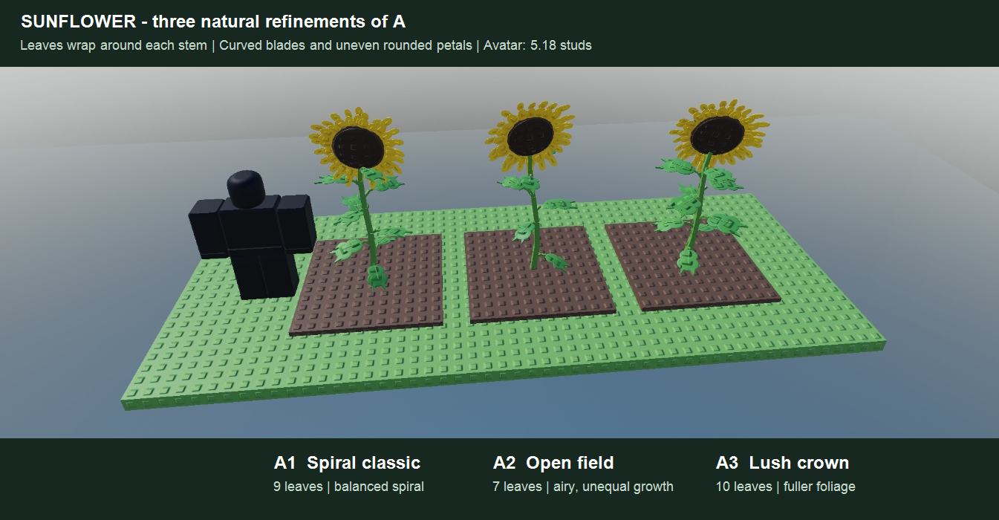

# Sunflower growth art

[Shared authoring workflow](../PLANT_GROWTH.md) · [Status](../ROADMAP.md)

## Natural refinements of A — awaiting selection

Ales preferred the original **A, tall classic**, but found its shape too artificial and its leaves confined to left/right rows
(2026-11-12). Keep the tall single-head direction. The revised studies give the stem a slight irregular bend, distribute unequal
leaves around all four sides, bend the petioles and blades, and replace the wheel-like crown with uneven rounded overlapping rays
and a convex dark disk. Leaf planes follow their radial growth direction, rather than all facing the viewer.

- **A1 — spiral classic (recommended):** nine unequal leaves wrap around the stalk; balanced foliage and one open golden head.
- **A2 — open field:** seven leaves, a more open silhouette, a slight sideways lean and an uneven petal crown.
- **A3 — lush crown:** ten broader leaves around the stalk, fuller foliage and a modestly nodding flower.

All are refinements of A, rather than the original B heavy seed head or C three-head branching alternatives.
[Initial silhouette comparison](../art/sunflower/ripe-studies.png) is retained as the decision record.

## References and growth direction

Ales supplied a [life-cycle illustration](../art/sunflower/reference-life-cycle.png) and
[flowering plant photo](../art/sunflower/reference-flowering.png) on 2026-11-12. Preserve a substantial green stem, broad pointed
leaves on staggered petioles, a large dark seed disk and a golden ray crown. The reference captions describe the plant;
they do not change gameplay. Fine hairs and individual serrations are omitted at gameplay scale.

The reference ends with seed release and a dried plant. The proposed game-ripe pose retains a golden crown around a dark textured
disk, with a modest head nod and limited lower-leaf aging. This intentionally combines flowering identity and seed-readiness cues.

After mature selection, use one deterministic `PlantKit.recipe` with `Draft = true`, shared timing/seed/size helpers, attached
stem and petiole growth, hinged leaf unfolding, a green bud opening into rays, a swelling/darkening disk and a late head nod.
Keep the head as one explicit visual harvest slot. Present five stills at 0/20/50/75/100% before field integration.
Head facing, seed/mass extremes, all-age bounds and detail proxies belong to the selected recipe's validation.

## Static study checks and scope

`tools/sunflower_natural_studies.luau` builds the revised comparison in Studio Edit. All three use standard mass, 5.5-stud soil
squares, the same camera and a 5.18-stud R15 avatar with its feet on the same ground plane. Part-corner radii fit the 2.4-stud
limit, with leaves checked in all four azimuth quadrants.

| Study | Leaves | Height | Radius | Parts | Built-in sphere meshes |
|---|---|---|---|---|---|
| A1 spiral classic | 9 | 7.64 | 1.83 | 146 | 95 |
| A2 open field | 7 | 7.84 | 2.14 | 124 | 83 |
| A3 lush crown | 10 | 7.58 | 2.08 | 157 | 101 |

Rounded blades, petals and disk faces use built-in `SpecialMesh` sphere ellipsoids inside the Parts; mesh instances are additional
to the Part count. These are static study costs, not production performance validation. The selected recipe should create its
bounded meshes once through framework hooks and pose the Parts through the shared Rig. No external mesh assets are needed.
The original angular studies remain reproducible with `tools/sunflower_ripe_studies.luau`.

The temporary revised display was removed after capture and the camera restored. The final boot had zero server/client warnings or
errors; the playtest was stopped. Localization build/check/lint pass with no changed strings. No `SunflowerPlant` module exists yet.

Stored ID `Sunflower`, existing **18-hour** duration, prices/rewards and whole-square harvest stay as built. No profile edits or
custom harvest feedback are part of this milestone. Growth, field integration and performance remain later gates.
