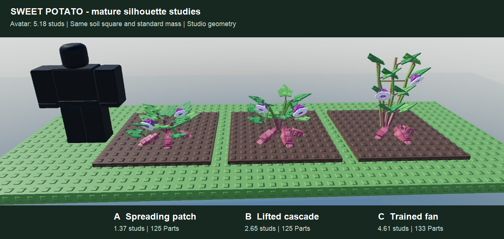

# Sweet potato growth art

[Shared authoring workflow](../PLANT_GROWTH.md) · [Status](../ROADMAP.md)

## Selected mature silhouette

Ales selected **C, the trained fan**, on 2026-11-12. Its continuous growth is built as a review-only draft, awaiting art approval.

Three static mature studies precede the continuous recipe, following the shared art review gates.
The supplied references guide organ shapes and growth; their captions are reference material, not game requirements.

- **A — spreading patch:** low unequal runners, broad heart-shaped leaves, two pale trumpet flowers and
  three reddish tapered root shoulders. The strongest silhouette difference from upright Potato.
- **B — lifted cascade:** a higher central crown with leafy arching runners descending toward the soil; larger exposed
  root shoulders remain visible below it. More upright readability without a rigid support.
- **C — trained fan:** three leafy vines tied to a small rigid fan support, inspired by the indoor reference. This is a
  supported ornamental interpretation, rather than the indoor bottle or a giant exposed mother root.

All studies use a 5.5-stud soil square, standard harvested mass and the same field-style materials, with an avatar for scale.
Leaves have a basal notch and a pointed tip; flowers have a flared pale rim, purple funnel and dark throat.
Ordinary Potato instead has upright unequal shoots, paired compound leaflets, small white/yellow star flowers and round brown tuber tops.
Sweet potato's exposed reddish root shoulders are an intentional harvest-readability shortcut; fine underground roots are omitted.
Flowers are an identity accent, not a claim that flowering determines the real crop's harvest readiness.

Reference images: [life cycle](../art/sweet-potato/reference-life-cycle.png),
[cultivation timeline](../art/sweet-potato/reference-timeline.png),
[indoor trained vine](../art/sweet-potato/reference-indoor.png),
[trumpet flowers](../art/sweet-potato/reference-flowers.png).

## Continuous growth and recipe

CG18a produced the three mature studies and a comparison image. CG18b builds the selected C as a `Draft = true`
`SweetPotatoPlant` recipe for the existing growth reviewer. No field art or saved data changes. Existing eight-hour timing
and whole-square harvest stay as built. Field integration follows approval of the five growth stills.
The static study runner is `tools/sweet_potato_ripe_studies.luau`; its disposable Studio folder is removed after capture.

| Growth | Pose |
|---|---|
| 0% | The full-sized fan is already installed. A tiny green slip breaks the soil between its feet. |
| 20% | Three unequal vines establish their lower stems and first unfolding heart leaves. |
| 50% | Successive nodes climb the fan; attached middle leaves open as the lower stems turn reddish. |
| 75% | Upper leaves continue to unfold, both pale trumpets open and small pink root shoulders emerge. |
| 100% | The selected fan canopy settles above three larger reddish tapered storage-root shoulders. |

[Five-pose sheet](../art/sweet-potato/growth-review.png) · [0%](../art/sweet-potato/growth-0.png) ·
[20%](../art/sweet-potato/growth-20.png) · [50%](../art/sweet-potato/growth-50.png) ·
[75%](../art/sweet-potato/growth-75.png) · [100%](../art/sweet-potato/growth-100.png).

[`SweetPotatoPlant.luau`](../../src/ReplicatedStorage/SweetPotatoPlant.luau) uses `PlantKit.recipe` for construction, reversible
posing, destruction and direct proxy generation. It reuses 133 Parts: five fixed supports, 12 stem segments, 72 leaf/stalk/vein
pieces, three ties, 15 storage-root pieces and 26 flower pieces. A hypothetical full-detail 36-square field would use 4,788
plant Parts before soil, pets and UI; this draft is **not registered in the field**. Proxy stages currently use 20 / 57 / 79 Parts.

Seed variation changes vine heights, lean, leaf angles/sizes and root proportions. Seed 1 retains the chosen C baseline.
Storage roots scale by the cube root of the server's harvested mass, including Sorter; their centres move inward at large
sizes. Foliage width is constrained, and rigid equipment does not scale with mass. Orientation and 5-stud ring height are fixed.
The three roots have stable fruit-slot IDs, mature attachments and explicit five-Part groups; flowers remain separate accents.

Studio playtest Client command: `require(game.Players.LocalPlayer.PlayerScripts.PlantGrowthReview).Open("SweetPotato", 10)`.
Ten seconds controls review playback only. Production duration remains eight hours, with the shared scheduler's 30-second cadence
when integration is approved. Harvest will continue to clear the entire square; organ metadata does not change gameplay.

## Growth validation

CG18b Studio checks (2026-11-12, `tools/sweet_potato_growth_checks.luau`) pass for six seeds, harvested mass 0.35656 / 1 / 3.02985,
101 ages, attachments, fixed supports, root metadata, physics/input flags, direct proxies and backward seeks. Maximum corner
radius is 2.181 studs, maximum all-age height 4.857 studs; the standard seed-1 mature baseline remains 4.609 studs tall with
2.038-stud radius. Crop-picker selection, Play/Pause, rings/selection border and Close were exercised through the real reviewer UI;
the field pet and soil were checked together. Server and client logs were clean, and the playtest was stopped.
Production lifecycle, field/24-plot performance, real phone and second client remain unvalidated.

## Static study validation

Studio Edit checks (2026-11-12): A / B / C use 125 / 125 / 133 plant Parts, measure 1.37 / 2.65 / 4.61 studs above soil and
have maximum corner radii 2.28 / 2.26 / 2.04 studs. The reference avatar is 5.18 studs tall. Rendered study checked after
correcting the pointed leaf wedges and separating the exposed roots. These are study counts, not a production recipe budget.
One Studio boot produced zero server/client warnings or errors; the playtest was stopped. The disposable study was removed,
the camera restored and both existing StarterGui screens left enabled. Localization build/check/lint pass with no changed strings.
